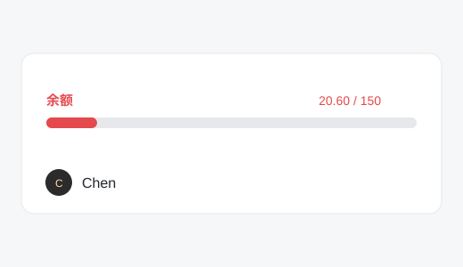

# dsh-balance-bar

A fuel gauge for your DeepSeek account balance, pinned to the bottom of the
[DeepSeek Harness](https://github.com/deepseek-ai/deepseek-harness) sidebar.



```
余额                    20.60 / 150
███████░░░░░░░░░░░░░░░░░░
```

## What it does

- **Red bar** — fill level = remaining balance ÷ cap.
- **Cap starts at 150 CNY.** If your balance ever goes above the cap, the cap
  is raised to the next multiple of 50 and **remembered permanently** (150 →
  200 → 250 …). It never shrinks back.
- **One click** opens the DeepSeek platform usage page.
- **Auto refresh** every 3 minutes, plus whenever the window regains focus.
- Turns red below 20% of the cap so a low balance is hard to miss.
- The number is **normal wallet + bonus wallet** (both are spendable).

## Requirements

- DeepSeek Harness **desktop** (tested on `0.2.1-rc.2`, Windows).
- A signed-in DeepSeek account — the balance is read through the Harness host,
  so no API key is involved.

> ⚠️ This plugin uses the Harness **client plugin API** (its slot system and
> `ctx.remote.account`), which is not a stable public contract yet. A Harness
> update may break it. If it stops working, just uninstall.

## Install

The plugin has no build step and no runtime dependencies.

### 1. Put the package inside your profile

```powershell
git clone https://github.com/Hulk-buster-23/dsh-balance-bar "$env:USERPROFILE\.dsh\profiles\desktop\plugins\dsh-balance-bar"
```

macOS / Linux: clone into `~/.dsh/profiles/desktop/plugins/dsh-balance-bar`.

### 2. Install it as a profile dependency

The Harness launcher builds its module resolution table from the profile's
`package.json` dependencies — copying a folder into `node_modules` is **not**
enough.

```powershell
cd "$env:USERPROFILE\.dsh\profiles\desktop"
pnpm add "file:./plugins/dsh-balance-bar" --offline
```

If `pnpm` is not on your `PATH`, use the copy bundled with the app:

```powershell
node "<install>\resources\runtime\primary-runtime\dependencies\node\bin\node.exe" `
     "<install>\resources\runtime\primary-runtime\dependencies\pnpm\bin\pnpm.cjs" `
     add "file:./plugins/dsh-balance-bar" --offline
```

### 3. Register it in `cordis.patch.yml`

Append to `~/.dsh/profiles/desktop/cordis.patch.yml`:

```yaml
- insert:
    - id: ui-balance-bar
      name: dsh-balance-bar
```

`- insert:` is required. A bare `- id:` line is read as a *patch of an existing
row*; the launcher then prints `patch: entry "ui-balance-bar" not found` to
stderr and silently skips it.

### 4. Reload

Press `Ctrl+R` in the app window, or restart the Harness. The bar appears just
above your avatar in the sidebar footer.

## Configuration

Optional, on the same patch entry:

```yaml
- insert:
    - id: ui-balance-bar
      name: dsh-balance-bar
      config:
        cap: 200                                     # initial cap, default 150
        label: 余额                                   # caption, default 余额
        usageUrl: https://platform.deepseek.com/usage # click target
```

`cap` is only the starting point: a higher real balance still raises it.

### Reset the raised cap

The remembered cap lives in the app's `localStorage` under
`dsh-balance-bar.cap`. Delete that key in DevTools to go back to 150.

## Troubleshooting

| Symptom | Cause |
|---|---|
| `patch: entry "ui-balance-bar" not found` in stderr | the `- insert:` wrapper is missing |
| Package installed but no bar | skipped step 2 — the package must be a profile dependency |
| Bar shows `…` forever | `"remote.account"` missing from `inject` (an incomplete service hangs instead of throwing) |
| Bar shows `not-ok` / `err:…` | host refused the balance call, usually a signed-out account |

You can validate the composed profile without restarting the app:

```powershell
Copy-Item "$env:USERPROFILE\.dsh\profiles\desktop" "$env:USERPROFILE\.dsh\profiles\desktopcheck" -Recurse
dsh --profile desktopcheck --dump-config      # prints the whole tree and exits
Remove-Item "$env:USERPROFILE\.dsh\profiles\desktopcheck" -Recurse -Force
```

(`desktop` itself may only be booted by the Electron app, hence the copy.)

## Uninstall

```powershell
# remove the inserted row from cordis.patch.yml, then:
Remove-Item "$env:USERPROFILE\.dsh\profiles\desktop\plugins\dsh-balance-bar" -Recurse -Force
Remove-Item "$env:USERPROFILE\.dsh\profiles\desktop\node_modules\dsh-balance-bar" -Recurse -Force
```

## 中文说明

给 DSH 桌面版侧边栏加一条余额血条：红色进度条 = 剩余 ÷ 上限，默认上限
150 元，余额超过上限就永久抬高（150 → 200 → 250…），点一下打开平台用量页，
窗口切回来会刷新，低于 20% 时变红。

安装就是上面三步：**克隆到 `plugins\` → `pnpm add` 装成依赖 → 在
`cordis.patch.yml` 里用 `- insert:` 注册**，然后 `Ctrl+R`。

三个容易踩的坑都写在上面的 Troubleshooting 里了。

## License

[MIT](LICENSE)
